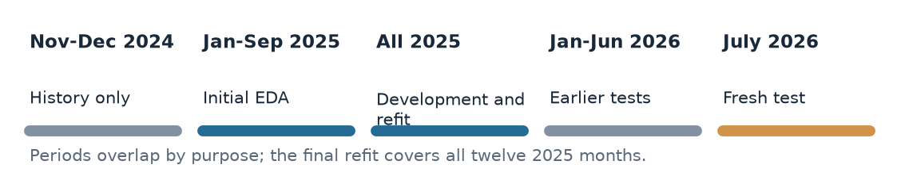
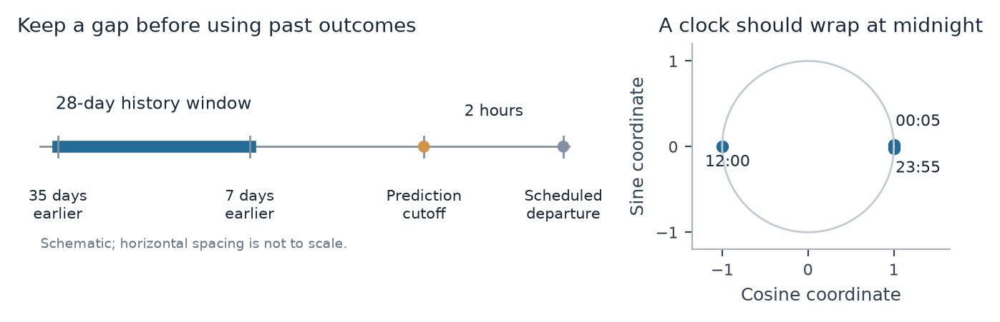
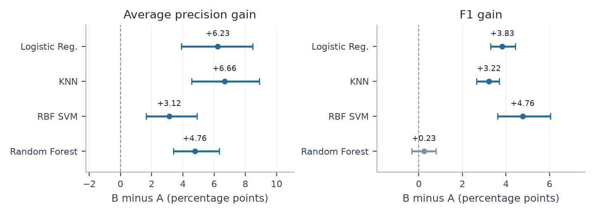

# Predeparture Flight Delay Classification

**Data extraction, cleaning, exploration and feature engineering**
ML and DW Project | 19 October 2026

This project studies whether a flight will depart at least 15 minutes late, using information that could be available two hours before its scheduled departure. The study covers Atlanta (ATL), Dallas Fort Worth (DFW) and Chicago O'Hare (ORD). Most of this report explains how the data was understood and prepared. Model results follow in the final two pages.

Richer inputs improved risk ranking, but the selected warning rule generated many false alarms. Reviewing a small list of the highest-risk flights was more selective.

### Project objectives

**Main objective:** develop and evaluate Logistic Regression, KNN, SVM and Random Forest in a historical two-hour prediction simulation, and assess whether their outputs can identify and prioritize delayed departures.

- **O1** Select a classifier using earlier validation and confirm its performance later.

- **O2** Measure the predictive value of weather, history and scheduled traffic beyond schedules alone.

- **O3** Identify supported patterns in missed delays and false warnings.

- **O4** Assess fixed review budgets of 5%, 10% and 20% against simple rankings.

### Raw sources and extraction

| Source | What was extracted |
| --- | --- |
| BTS monthly flight archives [3] | Flight dates, airlines, routes, scheduled times, distance, duration, cancellation flags and departure outcomes. |
| IEM ASOS and METAR archive [4] | Origin weather observations, raw weather messages and station metadata used to resolve time zones. |
| Raw airport reference [6] | Airport coordinates and elevation for wider route-feature experiments. These were candidates, not all final predictors. |

All twelve 2025 BTS files contained 7,001,619 national records. Reading in chunks retained 957,315 scheduled departures at the three origins. Raw files were preserved; a stable flight ID used the source month and original row number. Only raw inputs were reused from the earlier unrelated project.

Figure 1. EDA uses January-September 2025; final refits cover all 2025 months. Late-2024 records supply history. July 2026 is the fresh test.

## Cleaning the flight records

The shared preparation manifest is a log of the rules applied. The workflow covered univariate and bivariate analysis, missing values, outliers, variable creation and transformation. Source checks and the target definition came first so the plots used the correct population.

### Parse fields and check identities

Codes were trimmed, dates parsed and numeric fields checked. The audited numeric fields had no non-missing parse failures. Flight identities were checked using date, airline, flight number, route and scheduled time; an unresolved duplicate would stop processing rather than be silently deleted.

### Define the target and eligible population

The target is 1 when the signed departure delay is at least 15 minutes, and 0 otherwise. Early departures can legitimately have negative delay. The rebuilt label was checked against the BTS DepDel15 field [3]. Cancellation status was applied explicitly: a cancelled flight is not an on-time example.

| 2025 population decision | Flights |
| --- | --- |
| Scheduled departures at ATL DFW ORD | 957,315 |
| Cancelled and excluded from classification | 18,898 |
| Noncancelled flights with an unknown departure label | 0 |
| Eligible departures retained | 938,417 |
| Later-diverted flights included within those eligible rows | 2,750 |

Cancelled records remain useful as schedule context for traffic counts. A later diversion does not automatically invalidate a known departure label. This means the target is delay among operated flights with known outcomes, rather than cancellation risk for every published schedule.

### Missing values and impossible values

In the January-September training population, the core schedule predictors had no missing values. Missing outcomes among all schedules were handled through the eligibility rule, not filled with a guessed label. Missing weather predictors were retained for the model pipeline, as explained on page 5. Nonpositive distance or scheduled duration would become missing with an audit flag; neither rule changed a value in the audited handoff.

### Review outliers without deleting valid events

Outlier checks used the middle-50% spread (IQR), distance from the mean, and the upper 1% of values. IQR flagged 20,787 training distances and 27,641 durations, but a long route or schedule can be valid. No automatic IQR deletion or percentile capping was applied. Outcome delays were not capped because they define the target.

### Create a consistent clock

Scheduled HHMM values became minutes after midnight, then origin-local timestamps and UTC. Daylight-saving ambiguities were checked. The cutoff was set 120 minutes before scheduled departure. The current flight's actual departure and arrival information stayed outside its predictors.

## Understanding distributions before modeling

Univariate analysis examines one variable at a time. The EDA population contains **698,670 eligible departures** from January-September 2025. Of these, **180,527 (25.84%)** departed at least 15 minutes late. This imbalance makes an always-on-time classifier look reasonably accurate even though it detects no delays.

Figure 2. Complete training counts and delay distribution, plus a fixed-seed 10,000-flight scatter sample. The histogram zoom omits 12,380 observations from view only; the full-range box plot retains every delay. The 15-minute line defines the target, not an input.

### What the graphs show

The typical flight is quite different from the average delay. The median departure delay is **-1 minute**, while the mean is **17.1 minutes**. A small number of very long disruptions pull the mean upward. Observed signed delays range from -60 to 2,364 minutes. The box plot uses a symmetric log scale to display both the early departures and the long positive tail without deleting them.

Distance and scheduled duration are also right-skewed. Their training medians are 666 miles and 126 minutes, compared with means of about 759 miles and 139 minutes. The scatter plot shows their strong relationship: correlation is **0.986**. They contain overlapping information, so retaining both is a modeling choice to evaluate, not evidence that both independently explain delays.

These findings guided the later use of median imputation, scale-aware preprocessing and compact feature comparisons. The observed departure delay is plotted only to understand the outcome; using that same flight's delay as an input would leak the answer.

## Exploring relationships and hidden patterns

Bivariate analysis compares variables with each other or with the target. The graphs below use rates rather than raw delay counts, because a busy airline can have more delays simply by operating more flights. These are descriptive associations, not causal explanations or proof of predictive improvement.

Figure 3. All panels describe January-September 2025. The airline adjustment gives AA and F9 the same shared origin-month-time-band mix, requiring at least 30 flights per airline in a group; it retains 183,589 flights, or 99.4% of their combined population.

### Calendar and weather signals need context

Delay risk rose from **16.5% in the morning** to **35.5% in the evening**. June and July were higher-risk months than September in this single year. These patterns motivated cyclic calendar features and airport-specific time patterns, but they do not prove repeatable seasonality across years.

Flights matched to a positive precipitation-accumulation report had a **44.3%** delay rate, compared with **24.4%** for zero and **36.0%** for trace amounts. Accumulation describes an earlier reporting interval [4], not guaranteed rain at departure. Shared weather, airport conditions and the schedule can explain part of the difference.

### A crude airline ranking can reverse

Frontier (F9) had a crude rate of 34.58%, slightly above American (AA) at 33.64%. After giving both airlines a common origin, month and departure-band mix, F9 was at 29.44% and AA at 33.37%. This reversal shows how composition affects the comparison. Route differences remain, so it does not establish which airline would perform better on another airline's flights.

The deeper EDA also found a sharp shock at ATL on 10 January: 643 of 764 schedules were cancelled, and 112 of the remaining 121 eligible departures were delayed. Slow historical averages can miss such sudden bad days. Cancellation exclusions therefore change the population being described, not merely the amount of data available.

## Extracting weather and treating missing values

Weather was joined by origin and time, using the most recent qualifying earlier report. A report had to be at least **20 minutes older than the prediction cutoff**, allowing an assumed delivery buffer, and no more than **180 minutes old**. The code used a backward as-of match, which means it searched backward in time instead of taking the nearest report on either side.

Figure 4. Flight-weighted training missingness and matched-report age. Every training flight matched a qualifying report, but condition flags were unknown for 90.6% and gust values for 80.3%. The observed report ages were 20-139 minutes, with a median of 49 minutes.

### A weather report is not a complete set of measurements

IEM's M code can indicate an unreported, missing or quality-controlled value [4]. An absent gust was therefore left unknown rather than assumed to be zero. Trace precipitation became a numeric zero plus a separate trace flag, preserving the distinction from an ordinary zero. Negative physical quantities such as wind speed were treated as invalid; negative air temperature remained valid.

Ceiling height also needs a meaning-aware rule. No ceiling is required when only certain clear or scattered conditions are reported. The data therefore keeps separate indicators for no ceiling, unknown cloud coverage and unknown ceiling height. A missing ceiling number is not automatically a failed weather report.

### Improve extraction before adding new data

The four structured sky-layer columns did not contain every layer in the raw METAR body. Parsing all body layers before the RMK remarks section recovered known ceilings for **719 training flights**. This corrected a representation problem using existing raw data, without changing flight identities or labels.

For the original 2025/Q1 weather handoff, 4,871 identical overlapping rows were collapsed. Both versions at eight conflicting station-time keys were excluded rather than choosing arbitrarily. Earlier qualifying reports still covered every training flight. The same approved rule was carried into later acquisitions; raw payloads remained unchanged.

Another source convention matters: visibility was stored at exactly 10 miles for 87.7% of training flights. NOAA defines 10SM as 10 miles or greater [5]. Treating all such observations as identical precise measurements would overstate the information in the source.

## Building useful features and a fair model input

Figure 5. The timing diagram is a schematic of the history and prediction rules. Clock coordinates are a mathematical representation, not measured effects. They keep 23:55 close to 00:05 and avoid treating midnight as a large numerical jump.

| Feature family | Construction and reason |
| --- | --- |
| Calendar and schedule | Create weekday, month, departure bands and sine/cosine clock coordinates. Add richer time harmonics and airport-time interactions to represent different daily patterns. |
| Earlier delay history | Use a 28-day outcome window ending seven days before cutoff. Build airport, airline-origin, route and later flight-number histories, with support counts and no-history flags. |
| Scheduled traffic | Count origin schedules in the hour before scheduled departure. These are published schedules, including later cancellations; no actual future departures are used. |
| Weather context | Combine temperature, visibility, wind and earlier weather-window summaries. Dew-point spread measures how close temperature is to the dew point. Avoid summing overlapping precipitation reports. |
| Compact new candidates | Extract altimeter setting and its earlier three-hour change/range, variable wind and gust excess. Try squared weather terms, log transforms and inverse visibility. |

History rates for small routes are pulled toward the airport's earlier average using a fixed prior strength of 20. This smoothing prevents a route with only a few past flights from being treated as equally reliable as a busy route. The seven-day gap is a declared availability assumption, not proof that BTS outcomes were published daily.

Broader experiments also tested holiday timing, route geometry, categorical combinations and scheduled arrival waves. Incoming schedules used published arrival clocks with inferred dates and discrepancy flags. These remained candidates; the final models did not automatically retain every new feature. Final schedule A has **26 input columns**, the retuned reference has 66, and selected B has 78 for LR/KNN, 66 for SVM and 72 for RF. Counts are before one-hot expansion.

## Preparing and sampling model inputs

### Fit transformations on training data only

Category labels become yes/no columns (one-hot encoding), such as one column per airline. Missing continuous values use the training median, or middle value; the selected LR/KNN recipe handles binary flags separately with a zero placeholder plus missingness indicators. Unknown weather therefore remains identifiable. LR, KNN and SVM scale continuous inputs so units do not dominate; Random Forest does not require that scaling. Log transforms soften skewed magnitudes, and squared terms allow curved relationships.

All such fitted preprocessing stays inside the training pipeline. Models use the same fixed-seed flight IDs. Proportional month-by-outcome sampling preserves natural class proportions and keeps KNN/SVM practical; it does not balance the classes. Initial fits used 20,000 flights, followed by 20,000/40,000 comparisons; final fits used a shared 40,000-flight sample across all 2025 months. All eligible source rows remain stored.

### Why a validation period is needed

Training lets a model learn patterns. Validation compares settings, feature packages and warning thresholds on later flights. Final testing checks the frozen choice on new outcomes. A random split can mix earlier and later conditions and is less realistic for this time-dependent problem. The final development procedure used the three chronological folds below.

| Earlier training period | Threshold calibration | Later scoring period |
| --- | --- | --- |
| January-March 2025 | April 2025 | May-June 2025 |
| January-June 2025 | July 2025 | August-September 2025 |
| January-September 2025 | October 2025 | November-December 2025 |

### Sampling reduces computation rather than deleting the population

| Stage | Eligible population | Shared model sample |
| --- | --- | --- |
| Initial notebook training and EDA | 698,670 | 20,000 for initial fitting |
| Final all-2025 refit | 938,417 | 40,000 across all twelve months |
| Fresh July 2026 confirmation | 87,298 | 10,000 |

EDA rates and most distributions used all eligible initial-training rows; scatter plots alone used a 10,000-row display sample. Model fitting samples are a separate decision. The same flight IDs and labels are used across classifiers and paired feature sets, which makes comparisons fair. Natural class proportions are retained, rather than creating a 50/50 class balance.

A small sample can miss rare categories: four destinations, representing 67 initial-training flights, were absent from the original 20,000-row fit sample. The encoder accepts unseen categories without crashing, although their category-specific information is then unavailable. Fixed month sine/cosine coordinates also avoid treating an unobserved calendar month as an ordinary unknown category.

## Models and measured predictive results

Logistic Regression combines weighted inputs; KNN looks for similar training flights; an RBF SVM learns a flexible class boundary; Random Forest combines decision trees. Their settings, feature packages and warning thresholds were selected using chronological 2025 development, then frozen before July outcomes were loaded.

Logistic Regression was selected by mean development F1 (0.483), with AP as tie-break. Final warning thresholds used October calibration from January-September fits; all-2025 refits kept those thresholds. Because Q1/Q2 2026 had already been evaluated, July was reserved for the new confirmation.

| July model | F1 | AP | Precision | Recall | ROC AUC | Accuracy |
| --- | --- | --- | --- | --- | --- | --- |
| Logistic Regression | 0.540 | 0.566 | 38.1% | 92.4% | 0.733 | 49.3% |
| KNN | 0.545 | 0.532 | 40.1% | 85.3% | 0.706 | 54.2% |
| RBF SVM | 0.534 | 0.513 | 43.5% | 69.2% | 0.681 | 61.2% |
| Random Forest | 0.543 | 0.540 | 39.3% | 88.0% | 0.723 | 52.4% |

The July sample has 3,215 delays among 10,000 flights (population: 87,298). Precision is the share of warnings that are correct; recall is the share of actual delays detected. F1 balances them; AP summarizes ranking across thresholds. Always-on-time accuracy is 67.85% but F1 is zero; always-delayed F1 is 0.487 and seeded fair-coin F1 is 0.398.

**Logistic Regression B remains the validation choice.** Its July F1 is 0.540 and recall is 92.4%, but precision is 38.1%. It produced 2,971 correct warnings, 4,827 false warnings and 244 missed delays. Thus 61.9% of its warnings were false. KNN's higher July F1 does not change the earlier selection. LR fit in 0.37 seconds and scored 10,000 flights in 0.023 seconds; SVM took about 250 seconds and 14 seconds respectively on this run.

Figure 6. Richer B minus matched-settings schedule A on identical July flights. Points are observed gains; whiskers are paired 95% day-bootstrap intervals (300 draws, 31 days). They are conditional on the fitted models, not guarantees about future years.

All four AP intervals are positive for A to B. Random Forest's F1 interval crosses zero. Against the equally retuned 66-input reference, compact additions were mixed: LR F1 rose by 1.50 points but its AP interval crossed zero; KNN improved modestly; RF AP fell by about 1.00 point; SVM retained 66 inputs. Adding features did not guarantee better prediction.

## Conclusions limitations and references

### What the objectives established

**O1:** the chronological procedure selected Logistic Regression B. Its final scores demonstrate useful ranking but do not establish a reliable broad warning system. A high detection rate came with a large false-warning burden.

**O2:** weather, historical outcomes and scheduled traffic improved AP beyond schedule-only A on the same flights. Compact additions beyond retuned 66 inputs gave mixed results. The combined comparison cannot isolate the separate contribution of weather, history and traffic.

**O3:** many on-time flights were wrongly warned; the false-positive rate measures this share. For selected LR B, ORD's rate was 75.5%, versus ATL's 64.7%. In the evening it warned on 2,799 of 2,804 flights, giving 100% recall but a 99.7% false-positive rate. Unsupported small-group rates stay blank; the reporting rules require at least 200 group flights and 30 relevant outcomes or warnings.

**O4:** the top 10% LR review list contained **688 actual delays among 1,000 flights**: 68.8% precision, 21.4% of all delays captured and 2.14 times random lift. Historical risk found 442 delays in the same-size list. The model list still had 312 false alerts and left 2,527 delays outside it. At 5%/20% budgets it captured 359/1,222 delays. Ranks and outcome-independent tie order were fixed before evaluation.

### Limits and practical meaning

The result applies to one summer month at three hubs and to departures with known operated outcomes. Weather receipt, timely access to earlier outcomes and archived schedule availability are assumptions. Many flights share the same weather report, so they are not independent weather experiments. Reused development periods can introduce selection optimism; threshold transfer after refitting and seasonal mix changes can alter warning rates.

False positives are unnecessary warnings; false negatives are missed delays. Their relative cost depends on the intended action, and no operational costs were measured. Scores are uncalibrated risk scores, not verified probabilities. Aircraft rotation was excluded because assignment timing was unavailable. The study does not establish prevented delays or money saved. Additional years, genuinely timestamped operational inputs and a fresh future evaluation would support stronger claims.

### References and reproducibility

The organization follows the concise introduction, EDA, modeling and conclusion sequence in [1]. The related flight report [2] informed the emphasis on data preparation and feature explanations; it predicts arrival delay at departure and is not a comparable score benchmark. All numerical results in this report come from this project, not those examples.

[1] Carnegie Mellon University. [Linear Regression Project Requirements](https://stat.cmu.edu/cmsac/sure/materials/lm_project_requirements.html). Accessed 19 October 2026.

[2] Duperier Sauvestre and Leaf. [Modeling Flight Delays CS229 report 2016](https://cs229.stanford.edu/proj2016/report/DuperierSauvestreLeaf-ModelingFlightDelays-report.pdf). Accessed 19 October 2026.

[3] Bureau of Transportation Statistics. [Reporting Carrier On Time Performance field definitions](https://www.transtats.bts.gov/Fields.asp?gnoyr_VQ=FGJ). Accessed 19 October 2026.

[4] Iowa Environmental Mesonet. [ASOS AWOS METAR archive and variable definitions](https://mesonet.agron.iastate.edu/request/download.phtml). Accessed 19 October 2026.

[5] NOAA. [ASOS User Guide visibility and cloud conventions](https://www.weather.gov/media/asos/aum-toc.pdf). Accessed 19 October 2026.

[6] OurAirports. [Raw airport reference downloads](https://ourairports.com/data/). Accessed 19 October 2026.

Project evidence: the four notebooks in notebooks/simple/; reports/preparation_manifest.json; reports/final_models/selection.json; reports/evaluation_exports/final_july/. The interactive HTML dashboard presents O1-O4. Report figures are regenerated from saved data, without refitting models.

